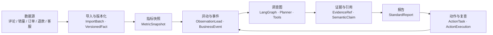
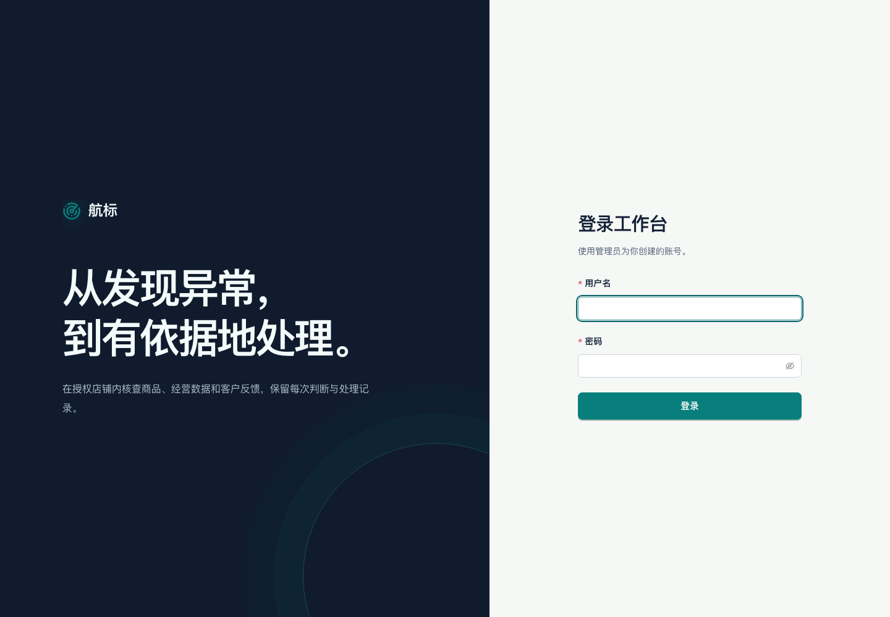
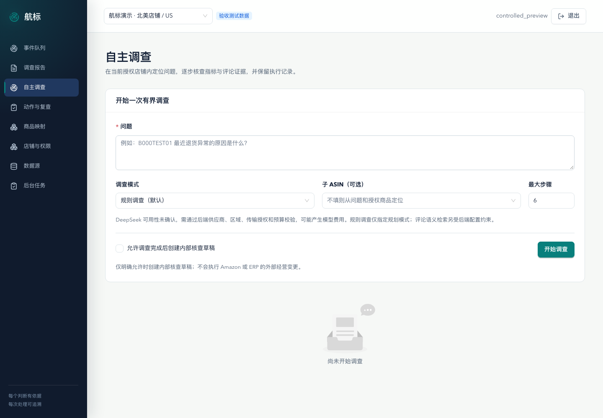
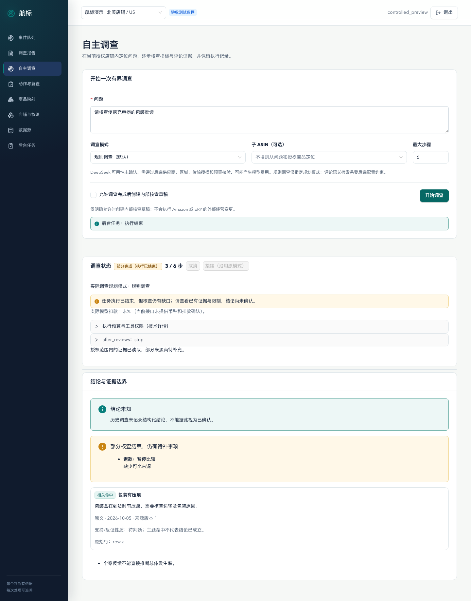
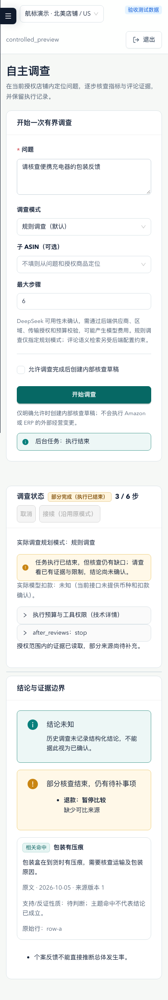

# 航标 Insight

面向跨境电商经营团队的商品经营异动分析工作台。当前工程主线是 **Django/DRF + PostgreSQL + Celery/Redis + LangGraph**，前端位于 `frontend/`。`backend/app/` 内保留 FastAPI 原型和部分被主线复用的模块；它不是默认启动入口，也不应整目录删除。

## 架构一览



完整的分层图、调查时序、关键设计与代码地图见 **[架构总览](docs/架构总览.md)**。

| 登录 | 发起一次有界调查 |
| --- | --- |
|  |  |

| 调查结论与证据边界（含缺口与"结论未知"降级） | 移动端同一结论 |
| --- | --- |
|  |  |


## 当前交付边界

这是可复现的内部演示和工程验收项目，不是已生产上线的系统。经营事实包主要是合成或派生数据；公开评论包含真实文本。确定性调查能验证受控工具路由、证据绑定和人工处理链路，不等同于真实模型正确性、真实商家业务收益或生产稳定性。

截至 2026-10-19，最新智能质量候选 `internal-demo-real-quality-20261014-full-budget-v35` 的离线协议检查为 `offline_protocol_passed`（300 分类、30 检索、48 调查，474 个替代请求，真实模型调度 0 次），`quality_accepted=false`。本轮 `make verify` 已完整通过；免费 planner comparison 和 05 号合成业务包也完成工程验收。它们不构成真实模型质量或真实商家收益验收。协议与引用检查通过不代表语义正确；独立评分和用户裁决仍未完成。评测既有失败材料保留，不能把历史部分结果拼成整轮通过。完整执行边界见[智能质量当前执行入口](docs/智能质量当前执行入口.md)。

## 安装与启动

需要 Python 3.11+、`uv`、Node.js 22.19+、pnpm 11 和 Docker Compose。先在仓库根目录准备本机配置：

```bash
cp backend/.env.example .env.local
```

编辑 `.env.local` 中的 Django 密钥、PostgreSQL 密码和 Redis 密码。该文件只用于本机，不要提交。示例文件已将本地 PostgreSQL/Redis 端口与开发数据库设为 `55433`/`56380` 和 `insight_dev`。默认开发服务使用独立 Compose 项目 `insight-local-dev`、命名 Celery 队列 `insight_dev` 和独立存储目录，不会复用或重建原有 `insight-v2` Compose 项目。

```bash
make install
make dev
```

工作台地址 <http://127.0.0.1:5184>，Django API 地址 <http://127.0.0.1:8280>，API schema 位于 <http://127.0.0.1:8280/api/schema/>。`make dev` 会启动本仓库隔离的 PostgreSQL/Redis、执行迁移，并监督 Django、Celery worker、Celery beat 与 Vite。API 或前端端口被占用、任一子进程启动失败或运行中退出时，`make dev` 会报告失败并停止本次启动的同组进程。`make dev-infra-down` 只停止 `insight-local-dev` 项目，不删除其持久化卷。

也可以分开运行 `make dev-infra`、`make migrate`、`make backend`、`make worker`、`make beat` 和 `make frontend`。若已有 `backend/.venv` 或 `frontend/node_modules`，`make install` 会使用锁文件做可复现安装。

## 验证入口

```bash
make verify
```

该入口包含 Django 检查、迁移差异检查、OpenAPI schema 验证、后端回归、前端单元测试和前端生产构建。默认后端回归排除带 `capacity` 标记的 502,400 行容量场景，不触发真实模型或付费评测。`make test` 使用单独的 Django 测试数据库（`test_insight_dev`）和隔离的 Redis 项目配置；测试数据库由 Django 建立并在结束后删除，开发数据库仅作连接入口。

```bash
make test-capacity       # 显式运行大容量导入验收，耗时和资源占用较高
make planner-comparison # 同输入/8步预算下固定流程与确定性 planner 的免费对照
make test-legacy         # 保留的 FastAPI 原型测试，不属于默认主线
make frontend-test       # 前端 Vitest
make build               # 前端 TypeScript 检查与生产构建
```

GitHub Actions 使用独立 PostgreSQL/Redis 服务，运行 Django 检查、迁移差异、全部非容量后端测试、Ruff、Vitest 和生产构建。浏览器全链路需要本地验收账号和隔离数据，未放进普通 CI。

## 可复现的业务案例

`backend/tests_v2/test_extended_acceptance_workflow.py` 提供快速集成回归。真实 API/Celery 和浏览器演示复用 `dataset/data/05_近期经营闭环_v1`、`dataset/data/06_S5动作效果场景_v1` 与 `scripts/run_business_package_acceptance.py`：

```bash
make business-acceptance DELIVERY_RUN=20261017T120000Z_internal-delivery DELIVERY_AS_OF=2026-10-01
```

该命令会先确保 `insight-local-dev` 的 PostgreSQL/Redis 健康，再按同一个新运行目录和隔离数据库依次执行导入与指标、动作/复查/复发、浏览器阶段。它显式使用 PostgreSQL 55433、Redis 56380、确定性 planner，并禁用语义、相关性和所有外部模型 provider；不会依赖旧 55432 服务或机器已有的付费模型配置。业务日期固定为合成数据包日期，不能替换成运行当天。输入、结果与隔离数据库保存在 `.local/acceptance-artifacts/` 和 `.local/acceptance-storage/`，不上传外部服务。最近一轮结果、范围限制及指纹记录在[内部交付状态](docs/内部交付状态_2026-10-19.md)。

`make planner-comparison` 在固定流程与项目确定性 planner 两组中使用同一组 48 个任务、同一数据包和 8 步上限，输出分组绑定的独立结果文件。合成契约分数为开发回归；真实模型组需要新的整轮预算与数据传输授权，未授权时不会发起。

## 数据与产物重建

仓库只版本化可复现所需的**输入**与**脚本**，不提交可重建的大体积产物：

| 路径 | 是否入库 | 说明 |
| --- | --- | --- |
| `dataset/data/01`–`06` | 是 | 评论、经营指标、黄金集、经营事实增强、近期经营闭环、动作效果场景 |
| `dataset/data/07_S4_S6独立评测_v1/`（除 `validation/`） | 是 | 成对调查场景、双语检索查询、qrels 与候选文档 |
| `dataset/data/07_.../validation/` | 否 | 评分/回放结果，重新运行即生成 |
| `dataset/data/08_S7容量评测_v1/import_ready/` | 否 | 502,400 行容量包，由生成器按需构建 |
| `dataset/data/acceptance_runs/` | 否 | `make business-acceptance` 的运行目录 |
| `.local/` | 否 | 本机凭据、运行状态与验收产物 |

重建方式：

```bash
# 容量包（502,400 行）与容量回归
cd backend && uv run --env-file ../.env.local python ../dataset/prepare_capacity_acceptance.py \
  --api-base-url http://127.0.0.1:8280
make test-capacity

# S4/S6 成对契约回放（确定性，不呼叫模型）
python dataset/score_paired_investigations.py --replay-contracts

# 端到端业务包验收（导入 → 指标 → 动作/复查 → 浏览器）
make business-acceptance DELIVERY_RUN=20261017T120000Z_internal-delivery DELIVERY_AS_OF=2026-10-01
```

重建后的结果文件会回到 `validation/` 与 `.local/acceptance-artifacts/` 的相同路径，`.gitignore` 已覆盖这些目录。

## 重要文档

- [经营异动 PRD](<完成经营异动项目需要的文档/01、经营异动-需求规格说明书（PRD）.md>)、[TDD](<完成经营异动项目需要的文档/02、经营异动-技术设计文档（TDD）.md>)、[开发步骤](<完成经营异动项目需要的文档/03、经营异动-开发步骤文档.md>)：v1.2 内部交付基线。
- [智能质量当前执行入口](docs/智能质量当前执行入口.md)：协议、语义、任务完成和业务收益的验收边界。
- [内部演示数据适用性核查](docs/内部演示现有数据适用性核查_2026-10-13.md)：评论来源、合成经营事实、黄金标注和切分限制。
- [S1–S7 剩余缺口执行清单](docs/S1-S7剩余缺口执行清单_2026-09-28.md)：历史工程记录，按最新交接状态解释。
- [S7 运行手册与发布门槛](docs/S7运行手册与发布门槛.md)：部署、备份、容量、恢复和上线门槛。

## 评测与业务数据边界

- 评论数据只覆盖当前授权的本地数据范围；固定验收子集上的召回指标不能外推为全库效果。评论文本是真实公开文本，经营指标和经营事件主要为合成或派生数据。
- 旧 gold 标签有 AI 标注和重复切分限制。开发调试中反复使用的样本只能作开发回归；独立评审由用户或独立评审者完成。
- 单次调用、单个调查 run 与评测轮次预算分别受运行时账本和评测脚本约束。新 run 会获得新的 run 级额度，不得借此绕过已批准的跨轮上限。新增工作空间日/月预算须由产品责任人确定金额后再配置。
- 真实模型 planner 对照、独立语义裁决、真实商家影子运行、收益签收和生产部署仍需各自授权与验收；免费替代执行不能作为真实模型质量结论。
