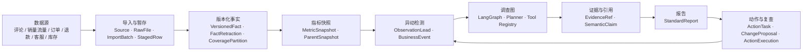
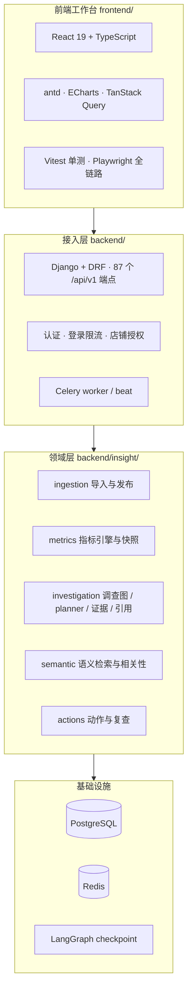
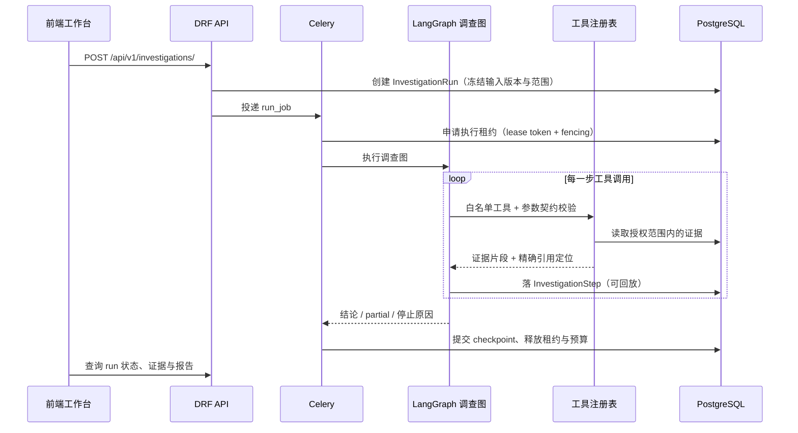

# 航标 Insight · 架构总览

> 面向外部读者与新接手同学的 10 分钟导览。完整业务口径见 [PRD](../完成经营异动项目需要的文档/01、经营异动-需求规格说明书（PRD）.md)，设计细节见 [TDD](../完成经营异动项目需要的文档/02、经营异动-技术设计文档（TDD）.md)。

## 1. 一句话定位

面向跨境电商经营团队的**商品经营异动分析工作台**：把"发现异常 → 定位原因 → 形成有依据的结论 → 处理与复查 → 记录效果"做成一条可审计、可复现的链路。

系统不追求"让模型自由发挥"，而是把模型放在**受控的调查图**里：能查什么、能得出结论到什么程度、能花多少预算，全部由代码与配置约束。

## 2. 业务链路



三个要点：

- **事实是版本化的**：同一来源可重复导入，但旧版本不会被静默覆盖；撤回与更正走 `FactRetraction`。
- **结论是可降级的**：证据不足时返回 `partial` / `unknown` 并写明缺口，而不是给一个看起来完整的答案。
- **动作是可回看的**：每次处理都有执行记录与复查任务，复发会重新进入异动队列。

## 3. 系统分层



`backend/app/` 是早期 FastAPI 原型与可复用模块，不参与默认启动路径，但其中的 `agent/`、`tools/`、`semantic/` 仍被主线引用，**不要整目录删除**。

## 4. 一次调查的执行时序



## 5. 五个关键设计

| 设计 | 解决的问题 | 主要实现 |
| --- | --- | --- |
| **输入冻结与可重放** | 同一 run 续跑时数据漂移，结论不可复现 | `investigation/freeze.py`、`assert_same_inputs`、`InvestigationRun.input_versions` |
| **执行租约与 fencing** | worker 崩溃/并发导致节点重复提交 | `WorkspaceExecutionLease`、`investigation/checkpoints.py` 的 `FencedPostgresSaver`、`pg_locks` 校验 |
| **预算与 fail-closed** | 模型调用失控、费用不可控 | `WorkspaceModelBudgetPolicy`、`investigation/budget.py`、`model_limits.py`；未配置额度时关闭外部模型路径 |
| **工具白名单与参数契约** | 模型越权调用、传参越界 | `app/tools/registry.py`、`app/tools/contracts.py`、`investigation/policy.py` |
| **结论不越界** | 把"检索命中"当成"结论成立" | `investigation/addressed_citations.py`、`citations.py`；输出带 `partial` / `unknown` 与缺口说明 |

配套的语义链路（`insight/semantic/`）只做候选召回与相关性标注，是否构成证据由调查图决定；质量候选与真实模型执行分别记录，避免把"配置了模型"当成"真实跑过模型"（见 `investigation/execution_config.py`）。

## 6. 代码地图

| 路径 | 职责 |
| --- | --- |
| `backend/insight/models.py` | 领域模型：工作空间、店铺、来源、版本化事实、指标快照、调查、事件、动作 |
| `backend/insight/ingestion/` | 导入、暂存、发布、撤回、原始文件留存 |
| `backend/insight/metrics/` | 指标引擎、口径校验、快照与 oracle |
| `backend/insight/investigation/` | 调查图、planner、工具策略、预算、证据绑定、引用 |
| `backend/insight/semantic/` | 语义检索、相关性、候选与评测 |
| `backend/insight/actions.py`、`action_review.py` | 动作、变更提案、复查与复发 |
| `backend/app/` | FastAPI 原型与可复用 agent / tools / semantic 模块 |
| `backend/tests_v2/` | 主线回归与契约测试 |
| `scripts/` | 验收、发布、审计与故障演练脚本 |
| `dataset/` | 数据构建、评测包与评分脚本 |
| `frontend/src/workbench/` | 工作台页面与交互 |

## 7. 质量与验证

一条命令覆盖主线检查：

```bash
make verify
```

包含：Django 检查、迁移差异检查、OpenAPI schema 校验、后端回归（默认排除 `capacity` 容量场景）、前端 Vitest、前端生产构建。CI 使用独立 PostgreSQL/Redis 服务运行同一组非容量检查。

最近一轮完整 `make verify` 的结果记录在 [内部交付状态](内部交付状态_2026-10-19.md)：后端 909 passed、4 skipped、1 deselected，前端 46 passed，构建成功。4 个 skip 都是需要显式提供评测输入的 opt-in 用例，不是失败。

## 8. 数据与评测边界

- 经营事实包以**合成或派生数据**为主；评论文本为真实公开文本。固定验收子集上的指标不能外推为全库效果。
- 协议检查通过、引用合法，**不代表语义正确**；独立评分与用户裁决未完成前，不宣称质量达标。
- 真实模型调用需要单独的预算与授权；未授权时系统 `fail closed`，不发起外部请求。
- 这是可复现的内部演示与工程验收项目，不是已生产上线系统。

## 9. 建议的上手顺序

1. 读本文第 2、4 节，建立"事实 → 指标 → 事件 → 调查 → 动作"的链路感。
2. 跑 `make install && make dev`，打开 <http://127.0.0.1:5184> 走一遍发起调查。
3. 读 `backend/insight/investigation/graph.py` 与 `planner.py`，理解受控调查如何收敛。
4. 读 `backend/tests_v2/test_core_execution_contract.py`，理解"系统不许过度声称"的验收方式。
5. 需要发布/运维时，读 [S7 运行手册与发布门槛](S7运行手册与发布门槛.md)。
