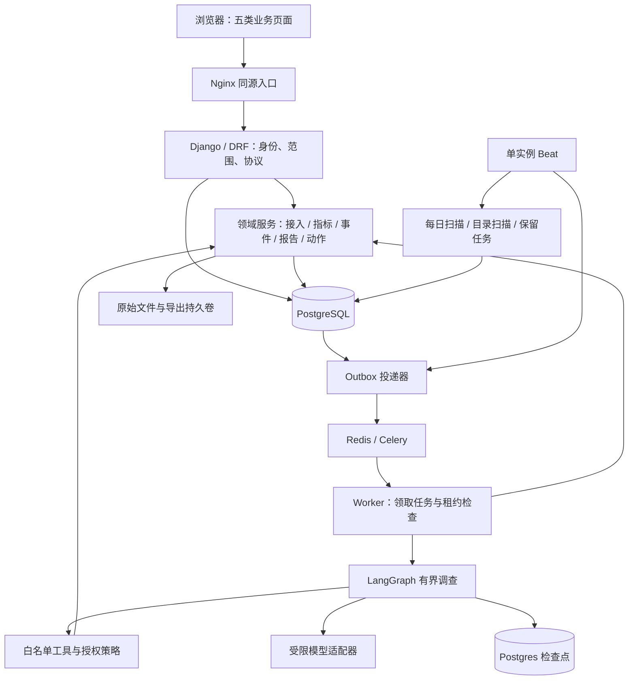
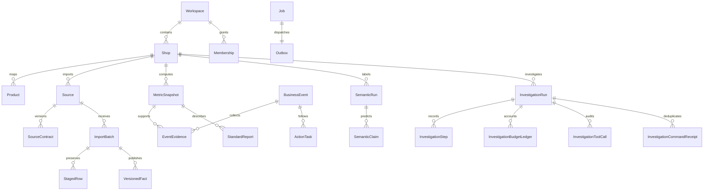
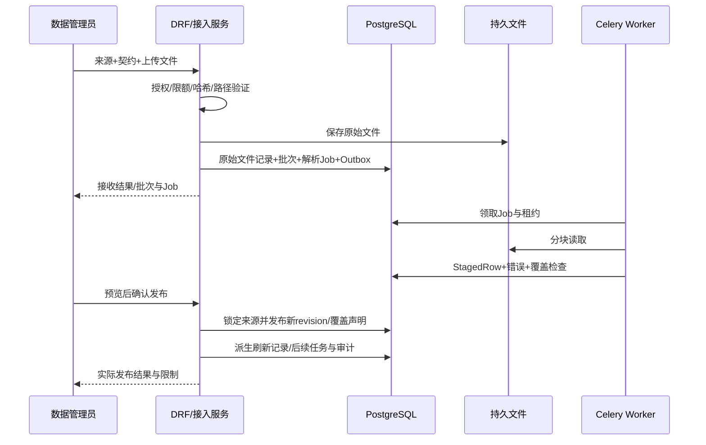

# 航标 Insight · 经营异动技术设计文档（TDD）

| 项目 | 内容 |
| --- | --- |
| 版本 | v1.2，2026-10-16 |
| 状态 | 完整初稿；源码定位与目标设计并列，不代替运行验收 |
| 输入 | [PRD](01、经营异动-需求规格说明书（PRD）.md)的 FR-01—13、AC-01—26 |
| 输出 | 选型依据、模块与数据契约、实现入口、故障处置、性能方法和验证要求 |
| 配套 | [开发步骤](03、经营异动-开发步骤文档.md)负责执行顺序及面试表达 |

## 0. 设计基线与实现事实

本文围绕已有 Django 主线解释和补齐设计；不会把历史 FastAPI 原型或框架提供的能力当成主线已经验收的能力。所有“目标”是需要通过验收的要求；“源码”仅证明存在实现入口。2026-10-16 未重跑服务、测试、付费模型或压测。

| 层次 | 当前可核对事实 | 必须保留的限制 |
| --- | --- | --- |
| 后端 | `backend/config` + `backend/insight` 为 Django/DRF 主线 | `backend/app` 保留历史原型和部分复用语义/Agent 适配，不是已完成双栈拆除 |
| 数据 | PostgreSQL 事实、版本、快照、事件、任务和审计模型存在 | 表存在不代表全部真实来源已接入 |
| 后台 | Celery/Redis、Job/Outbox、租约与锁检查可定位 | 故障恢复仍须绑定具体版本验证 |
| 调查 | LangGraph + Postgres checkpointer、规则/模型 planner 可定位 | 当前图为受限路由和文本局部循环，不可表述为任意领域工具自由循环 |
| 模型质量 | 真实请求、错误、费用预留和专项修复记录存在 | 最新完整质量和独立裁决未确认达标 |
| 检索 | PostgreSQL 全文、词表、语境/相关性、可选向量候选代码存在 | 向量候选非默认已证实更优方案，须按实际启用配置报告 |
| 前端部署 | React/TS/Ant Design；`compose.v2.yml` 与 Nginx 配置 | 原总体方案的 Caddy 是设计记录，当前部署文件实际为 Nginx |

## 1. 从业务需求推导技术决策

### 1.1 关键约束

数据正确性和可回查性优先；多人访问必须授权；调查持续时间长于 HTTP 请求；动作跨多天；同一原始数据会修正；模型会超时、输出非法结构或引用错误；单机资源有限。由此需要事务数据库、持久任务、版本绑定、领域计算和受控工具，而不是仅搭一个对话 API。

### 1.2 技术选型与取舍

| 决策 | 选择与原因 | 替代方案及代价 | 更换触发条件 |
| --- | --- | --- | --- |
| 后端框架 | Django 5.2 系列 + DRF：权限、ORM、迁移、事务和后台管理集中 | FastAPI 适合轻量推理接口，但本项目要额外拼装多项业务基础能力 | 仅当独立推理服务有隔离需求；不因异步标签再加一套服务 |
| 主库 | PostgreSQL：关系约束、事务、JSONB、全文检索、锁 | SQLite 适合本机原型；数仓/ClickHouse 增加双写与运维 | 持续实测聚合/写入容量无法满足，且索引/增量无效后评估 |
| 架构 | 模块化单体，业务与后台共用领域服务 | 微服务增加跨服务事务、鉴权和观测成本 | 多团队独立发布或明确扩展瓶颈出现时 |
| 后台 | Celery + Redis，数据库 Job/Outbox 作业务记录 | 进程内 create_task 不保证重启恢复；只有 broker 状态不足以审计 | 当前规模先完善任务可靠性，不先引入复杂工作流平台 |
| 流程 | L1 纯 Python 服务；L2 LangGraph StateGraph | 全部交给 Agent 不稳定；仅固定脚本无法据新证据探索 | 成对证据证明模型决策有价值时启用相应真实 planner |
| 模型接入 | HTTPX/Pydantic 适配、受限 schema、版本化配置 | 通用 Agent 再嵌 Agent 会叠加重试和权限边界 | 兼容收益经测试高于额外复杂度时才调整 |
| 检索 | PostgreSQL 全文+分词/别名，按需加候选通道和相关性 | 纯向量可能漏精确对象、缩写、否定；独立向量服务增加版本同步 | 冻结集证明召回不足，且候选增益/延迟/成本满足门槛 |
| 前端 | React + TypeScript + Ant Design + TanStack Query | Vue 可行；当前主线无需重写；SSR 对内部工作台收益有限 | 产品场景实变时再评估 |
| 部署 | Linux + Docker Compose，当前 Nginx 同源入口 | Kubernetes 对单机小团队增加成本 | 多节点可用性目标明确且有运维资源时 |
| 导出 | CSV + HTML/JSON，保留版本和引用 | PDF 不是本次业务依赖；Word COM 绑定 Windows/Office | 用户确有固定版式交付需求时单独设计 |

源码版本依据为 `backend/pyproject.toml`、`backend/uv.lock`、`frontend/package.json`、`frontend/pnpm-lock.yaml`、Dockerfile 与镜像配置。声明下限不等于安装版本；面试或发布引用实际 lock/镜像 digest。后端声明 Python≥3.11，当前主线镜像为 Python 3.13；不能混写成代码只支持 3.13，也不能声称所有允许版本都测过。

## 2. 架构与责任边界



HTTP 层负责请求、身份与序列化；领域服务负责业务不变量、事务和审计；计算函数负责确定性计算；模型仅提出结构化决定或预测；工具适配负责范围、版本、预算和返回契约。Celery 分发任务，LangGraph 保存调查内部状态，二者不同时定义同一业务步骤的权威状态。

报告页面通过任务/调查详情刷新进度。当前主线不能套用探渊 WebSocket 事件协议；未来改 SSE/WS 也需保留服务端持久状态、重连游标和授权。进度为实际已完成步骤或阶段，未估算总工作量时不能伪造百分比。

### 2.1 模块到代码

下表路径以项目根目录为基准，作为实现导航；这些入口可能包含多项职责，不代表已完成理想分层。

| 领域 | 主要文件/函数 | 关联需求 |
| --- | --- | --- |
| 身份与范围 | `backend/insight/access.py`、`administration.py`、`models.py` | FR-01、12 |
| 接入 | `backend/insight/ingestion/contracts.py`、`service.py`、`directory.py`、`api.py` | FR-02 |
| 事实选择 | `backend/insight/metrics/facts.py`、`versions.py` | FR-02、03 |
| 计算/检测 | `metrics/daily.py`、`cohort.py`、`occurrence.py`、`absolute.py`、`statistics.py`、`service.py:scan_object` | FR-03、04 |
| 事件/通知 | `metrics/service.py`、`severity.py`、`grouping.py`、`event_commands.py`、`scheduling.py` | FR-05、11 |
| 语义/检索 | `semantic/service.py`、`retrieval.py`、`indexing.py`、`relevance.py`、`safety_context.py`、`trends.py` | FR-06、07 |
| 规则报告 | `semantic/diagnosis.py:build_diagnostic_payload`、`validate_diagnostic_payload`、`report.py:compose_report` | FR-08 |
| 调查 | `investigation/api.py`、`graph.py:build_graph/execute_investigation`、`planner.py`、`policy.py` | FR-10、13 |
| 引用/输出 | `investigation/citations.py`、`addressed_citations.py`、`output.py:compose_output`、`business_schema.py` | FR-08、13 |
| 任务与恢复 | `tasks.py:dispatch_outbox/run_job`、`execution.py:check_execution`、`investigation/checkpoints.py` | FR-12、13 |
| 动作/复查 | `actions.py`、`proposals.py`、`action_review.py`、`investigation/commands.py` | FR-09 |
| 导出/保留 | `exports.py`、`retention.py`、`derived.py` | FR-11、12 |
| 业务页面 | `frontend/src/workbench/` 下 EventPage、ReportsPage、InvestigationPage、ActionsPage、SourcePage 等 | FR-01—13 的交互 |

## 3. 数据模型与存储契约

### 3.1 关系总览



图表达业务关联，`VersionedFact` 是 Django 抽象基类，不是独立物理表；报告/事件的详细关联以迁移和字段为准，不能直接把 ER 示意图当建表 SQL。

### 3.2 实体与关键不变量

| 实体 | 保存什么 | 唯一性/一致性要求 |
| --- | --- | --- |
| Workspace/Membership/ShopGrant | 用户、工作空间、角色、店铺授权 | 用户角色与对象范围共同校验 |
| Product/ProductMapping | 站点、子 ASIN、SKU、履约和有效期 | 对象身份不歧义；mapping version 不覆盖 |
| Source/SourceContract | 主来源、字段映射、时间/粒度/完整性语义 | 每店每种主来源唯一；契约版本唯一 |
| RawFile/ImportBatch/StagedRow | 文件哈希、批次、原始行与解析结果 | 批次+行号唯一；文件保持可回查 |
| 各 VersionedFact 子表 | 标准业务字段、business_key、revision、原始行 | `(source,business_key,revision)` 唯一；查冻结 revision，不查任意最新 |
| CoveragePartition/FactRetraction | 完整窗口、撤回与修正依据 | 缺行含义依契约，不用无记录自动补零 |
| MetricSnapshot | 来源 manifest、规则/映射版本、窗口、指标 payload | fingerprint 唯一复用；旧快照不可被新数据污染 |
| SemanticRun/Claim/ReviewResult | 输入、模型版本、预测跨度、逐条结果 | 已处理与已分析区分，失败不能伪装负例 |
| BusinessEvent/EventEvidence | 持续问题、级别、状态、快照关联 | 开放问题族合并；证据追加幂等 |
| ActionTask/ChangeProposal/ActionExecution | 草稿、确认版本、执行与复查记录 | 精确 payload 和实体版本批准；执行回执防重复 |
| Job/Outbox | 发起身份、payload、状态、租约、投递 | `(shop,actor,kind,idempotency_key)` 唯一，一 Job 一 Outbox |
| InvestigationRun/Step/Decision | 运行范围、输入版本、步骤、决定与终态 | run+sequence / 非空 logical_key 等唯一约束 |
| BudgetLedger/ToolCall/CommandReceipt | 调用消耗、工具审计、写命令回执 | run+幂等键唯一；状态恢复不重置消耗 |
| RetentionTombstone/DerivedRefresh | 删除和派生物失效记录 | 删除不虚构原文；派生状态可追溯 |

### 3.3 为什么既保存标准列又保存 JSONB

对象、日期、版本、状态和关系用标准列，保证过滤、约束、连接和索引；来源扩展字段、结果 payload、模型结构化输出用 JSONB。JSONB 不是免建模方案：稳定查询维度应进入明确字段，频繁 JSON 路径查询需实测索引。金额使用 Decimal/数据库 decimal，比例尽量保留分子分母，最后显示舍入。

### 3.4 来源快照与指纹

快照身份至少包含：授权业务对象、来源修订 manifest、映射版本、规则配置版本、窗口/业务日期、历史或实时模式；涉及语义时再绑定标签和索引版本。使用规范化 JSON（稳定键顺序、日期与 Decimal 编码）生成 SHA-256；不能直接拼接有歧义字符串。

同一输入复用已有快照；旧报告可保存原版本引用，但“所有工具都能在来源变化后继续旧快照”不符合当前实现。`freeze.py:assert_same_inputs` 比较运行和 checkpoint 的冻结指纹，并不保证底层原文仍存在；`orders.py:read_order_records` 另比较当前 `source_manifest(shop)`，不同即拒绝并要求重新冻结。哈希只证明身份/完整性。

| 变化 | 当前可定位行为 | 继续／停止／关联新运行 |
| --- | --- | --- |
| 来源新增/主来源切换、revision 修订 | manifest 仅含主来源 ID、kind、revision；非主来源新增不一定改变它。订单工具和 compose 的订单复核要求与当前一致 | manifest 变化即拒绝旧运行的订单读取；其他已存步骤可复用，不保证整个调查继续成功。最新来源须另行冻结：普通新建与导入派生刷新有不同入口，见下表 |
| 事实撤回 | `latest_facts` 只应用 `effective_revision <= 冻结 revision` 的撤回；旧 revision 仍可查询保留事实 | 历史快照不被新撤回改写；当前 manifest 改变时订单仍拒绝，不能把撤回忽略等同于有权继续所有工具 |
| 原文/原文件因保留策略删除 | retention.cleanup_retention先保存raw_file墓碑与拒下载标记，再删磁盘文件；结构化事实不等于原文件，review文本保留另受claim引用约束 | 旧指标可保留，原文件下载停止；原文已删则不能靠hash恢复。test_retention_removes_raw_payload_but_keeps_tombstone有专项定义；未证明每类工具对所有删除组合均有统一墓碑响应 |
| 成员/店铺/原始来源权限撤销 | replayable 每节点重查角色/对象；工具 policy、来源访问及详情 API 另查权限 | 停止相关读写，不能靠 checkpoint 绕过；已提交合法动作保留，撤权后的展示另受 API 控制 |
| 映射/规则/工作流变化 | input_versions 含 mapping_versions、rule_version、workflow_version；指纹一致检查只防状态被替换 | 已有快照可保留；不等于固定了所有环境配置。采用新配置须先确认兼容和授权，再发起新调查；当前普通新建 API 不建立 previous_run 关联，也没有通用配置刷新关联接口 |
| 模型/Prompt/环境配置变化 | `execution_config.configuration_snapshot` 记录选择；恢复仍读取部分当前环境，没有证明全配置不可变执行 | 不宣称旧模型配置完整恢复；需配置比对与兼容门禁，差异未闭环时停止付费恢复并新建获授权运行 |

当前调查入口必须分别描述，不能统称“API 新建关联运行”。下表 API 前缀均为 `/api/v1/investigations/`，实现位于 `backend/insight/`：

| 路径与入口 | 条件与输入 | 运行身份、关联与预算 |
| --- | --- | --- |
| 普通新建：`POST /api/v1/investigations/` → `investigation/api.py:create` | 显式提交新调查，检查角色/对象、幂等键及同范围正在运行的重复请求；按新运行流程冻结输入 | 创建新 run；请求字段不含 `previous_run`，实现也不设置该关联。按请求设置新的步骤额度，不是旧运行接续或跨 run 累计预算控制 |
| 原运行接续：`POST {id}/resume/` → `investigation/api.py:resume` | 仅 `partial/cancelled`；要求恢复记录完整且 `steps_used < max_steps`，重新校验权限 | 新建 Job、沿用同一 run，保留步骤与原预算；不是切换来源/配置的刷新接口。后续工具仍可因 manifest 变化而拒绝读取 |
| 定位澄清：`POST {id}/clarify/` → `investigation/api.py:clarify` | 仅 `needs_clarification`；补充对象/日期范围，剩余 `max_steps - steps_used` 至少为 3 | 创建子 run 并设置 `previous_run`，额度只取剩余步骤；继承 planner 选择与内部草稿请求。不能用来任意刷新已完成调查 |
| 导入派生刷新：`metrics/scheduling.py:schedule_after_import` → `derived.py:enqueue_derived_refresh` / `refresh_derived` | 主来源批次发布或撤销发布后，按受影响 ASIN 为符合筛选条件的既有派生物排队；不是手动调查 API | 调查分支可复用已刷新版本，或创建 `previous_run` 关联的 `read_only_refresh=True` 后继，绑定新指标/语义输入；新后继复制前一运行的 `max_steps/budget_units`，不等于接续共享累计账本 |

派生刷新入队时，调查筛选为尚无后继且状态在 `queued/running/completed/partial` 的运行；执行时沿后继链定位最新运行，若仍为 `queued/running` 则等待依赖。若其原语义运行的 provider 不在 `deterministic/test/disabled`，或其状态已为 `cancelled`，刷新记录转为 `needs_confirmation`。这个分支检查的是**原语义 provider 和取消状态**，不能据此宣称所有真实 planner 或付费情形都有统一确认门禁；新后继也不会复制原 planner 选择。`needs_confirmation` 是待确认状态，不代表已经实现通用“确认后刷新”API。纯映射/规则/模型配置变化，不能假设会自动进入上述导入依赖路径。

目标是每类读取均有明确版本可用性与墓碑契约；当前工具差异、配置兼容及跨 run 预算仍须保留为债务。新 run 或 `previous_run` 关联本身都不是自动切换原运行输入、自动重试收费的授权。对应测试：`test_occurrence_workplan.py::test_order_read_rejects_unbound_or_changed_source_manifest`、`test_investigation_recovery.py::test_node_receipt_replays_after_checkpoint_failure_without_latest_reads`；本次仅检查源码，未运行。

## 4. 数据如何从文件到可查询事实

### 4.1 接入流程



实现入口为 `accept_upload`、`parse_batch`、`save_chunk`、`publish_batch`、`revoke_published_batch`。文件保存成功但数据库失败的孤立文件，需要可审计清理；数据库指向的文件不允许未经保留策略直接删除。

### 4.2 校验与幂等

按层检查编码/表头 → 字段类型与必填 → 对象映射 → 来源原生粒度 → 日期/币种/数量语义 → 业务键重复 → 窗口完整性。错误行保留原行和原因，拒绝或明确部分发布；不能因为能读 CSV 就认定可计算。

文件哈希只能识别字节级重复；业务幂等由来源、business_key、payload_hash 和 revision 处理。同内容换行/重排不会重复累计；同业务键新内容作为修订，不将旧新一起求和。撤回发布写撤回记录并重算派生物，不能只删除 UI 批次。

目录扫描只处理授权根目录和文件模式，防路径穿越和符号链接越界；任务以来源执行身份重查权限。文件仍在写入时不抢读，稳定性策略需在来源契约中明确。

## 5. 指标、检测与事件的执行机制

### 5.1 计算顺序

1. 授权对象，选择各域主来源和冻结 revision。
2. 依据本指标真正依赖的来源，求共同完整截止日和可比窗口。
3. 对有效版本事实做去重聚合，分别算 daily、absolute、cohort、occurrence。
4. 进行零分母、基线不足、成熟性、币种和来源粒度检查。
5. 计算变化、区间与阈值；保留比较限制和不满足的具体前提。
6. 保存 MetricSnapshot；实时扫描再更新事件/通知，历史回补默认只生成历史快照。

`metrics/service.py:scan_object` 当前在事务中锁定 Shop，再创建/复用快照并管理事件。它用较粗粒度锁换一致性；这是小规模设计取舍，同时也是同店多对象并发的潜在瓶颈。不能说已采用按商品锁或无锁并行。

### 5.2 聚合与统计约束

比例跨日先求和分子分母，不平均日比例。7 日对 28 日数量先化日均或计算当前窗口的基线预期。订单退款队列对对象内订单去重，部分退款只计一单，冲正按生命周期处理；退货申请与仓库收到不能混成同一事件。

成熟性必须按首次发货、30 日边界及追踪完整性一起判定；不能只看时间够老。结构变化先看各子体，再做整体解释；不得把父体率直接赋给每个子体。Wilson/Newcombe/Fisher/BH 的适用范围见 PRD，统计实现入口 `metrics/statistics.py`。

若只描述基线偏离，不额外编造 p 值。多个指标和多商品监控仍有误报风险；阈值、显著性、事件持续和人工回查各自解决不同问题，不能声称 BH 已解决所有告警误报。

### 5.3 事件事务

幂等扫描键与事件业务键分开：前者区分输入快照，后者连接同对象同问题族的持续事件。相同扫描重复执行复用结果；新数据更新同事件证据；明显恶化才通知。人工合并/拆分使用命令记录和实体版本。

处理状态与当前信号分开：数据不足导致无法计算不等于异常消失；指标恢复也不自动证明动作有效。`evaluable_metrics` 区分“已恢复”与“已不可测”。并发更新要按当前状态重查转换，不使用前端旧状态直接覆盖。

## 6. 语义抽取、检索与证据

### 6.1 语义任务

离线/后台抽取主题、极性、安全语境与原文跨度；运行中调查不为全量评论重复付费抽取。每条预测绑定原始记录及 revision、输入 hash、模型/Prompt/taxonomy/schema、调用回执和失败状态。`SemanticReviewResult` 可记录逐条处理结果，避免只算成功 claim 而看不到失败分母。

输出经 schema → 合法主题对 → 编号/跨度回查 → 对象版本 → 业务规则校验。原句编号必须映射到本次请求的冻结原文；不能容许模型“差不多复述”。但编号合法只证明引用来自输入，不证明极性、主题或语义判断正确，仍需独立评测。

### 6.2 检索流水线

授权范围/冻结来源 → 对象/时间/来源过滤 → 分词与别名 → 全文或词法候选 → 可选向量候选合并去重 → 可选相关性判定 → 原文与覆盖信息返回。

当前 `retrieval.py` 使用 SearchVector/SearchQuery/SearchRank、词表与语境处理；`vector_candidates.py` 与 `relevance.py` 提供额外候选/判定入口。实际启用取决于配置；不能只看到文件就说混合检索或重排已上线。中英文、否定和假设需专项测试；不能单靠 embedding 相似度决定安全事实。

候选召回数量、最终 Top K、相关性与总体覆盖分别记录。候选预算或分页截断返回 `retrieval_complete=false`、has_more/限制；范围内背景上下文不能冒充相关命中，无命中不能冒充不存在。查询文本中的“最近”“US”不能替代服务端范围过滤。

### 6.3 统一证据对象（设计契约）

```json
{
  "evidence_id": "stable-ref",
  "type": "metric_or_original_span",
  "scope": {"shop_id": "uuid", "child_asin": "B000TEST01", "product_id": null},
  "window": {"start": "2026-10-01", "end": "2026-10-07", "timezone": "America/Los_Angeles"},
  "data_as_of": "2026-10-07",
  "coverage_status": "ready",
  "input_fingerprint": "sha256",
  "source_refs": [{"batch_id": "uuid", "raw_row_id": "uuid", "revision": 3}],
  "value": {"numerator": 70, "denominator": 700, "unit": "units_per_session"},
  "text_span": null,
  "limitations": []
}
```

此为统一语义示例，不是新增 HTTP schema。当前指标引用与原文引用分支由 `citations.py`、`addressed_citations.py`、序列化器定义。必须保留类型差异，不能一律用自由文本字符串指代。回查需验证存在、权限、对象、窗口、版本、数值/原文和偏移；来源删除后显示墓碑，不生成替代原句。

### 6.4 报告 Guard 的能力边界

Guard 能拒绝不存在/越权/错范围引用，核对结构化数字与原文跨度，并限制业务字段。它不能凭“引用合法”证明自由文本因果成立。当前 `compose_output` 将合法引用的解释保留为 `pending_adjudication`，缺有效引用保持 `unknown`；这是正确的限制表达，不应改成“AI 已验证根因”。

标准事实用受限模板；探索解释与支持/反证分列；缺源维度不列为已排除。报告字数、调用源数量、重试次数均不能作质量替代指标。

## 7. 有界 Agent 设计与当前图差异

### 7.1 目标循环

目标为 Authorize → ResolveScope → EnsureL1 → Decide → Validate → Execute → Record → CheckStop → Decide，最终 Compose → ValidateOutput → Save。只有无依赖只读调用可并行；写命令顺序执行。取消、撤权、等待澄清、待数据可从守卫退出。

### 7.2 当前源码图（实际可定位）

`graph.py:build_graph` 当前节点为 `locate / choose / metric_snapshot / order_records / review_claims / text_evidence / write_task / compose`。结构是：

```text
START → locate → choose
choose → metric_snapshot | order_records | review_claims | text_evidence | compose
metric_snapshot → order_records | review_claims | text_evidence | write_task | compose
review_claims → text_evidence | write_task | compose
text_evidence → text_evidence | write_task | compose
order_records → compose
write_task → compose → END
歧义分支 → END（保留待澄清状态）
```

部分节点内部会再次调用 planner，但边集合本身没有通用“每类证据都回到 choose”。因此不能声称订单核查后可任意返回库存/价格工具，不能据 LangGraph 存在就证明完整探索能力。下一步按 AC-22 的成对案例确定实际需要的回边和领域工具；每次扩大可执行路径都需预算、去重、权限与终态回归。

### 7.3 决策与工具契约

当前 `PlannerDecision` 包含 next_tool、tool_args、hypothesis、counter_evidence_query、stop_reason、clarification、final_answer、conclusion、business_contract、model_receipt 等字段。模型协议和 wire schema由适配器维护，不能把这个 dataclass 的全部内部字段都开放给模型。

下列是 `graph.py:build_graph` 的闭包节点，统一签名为 `node(state: InvestigationState)`，并非五个对外可任意传参的 RPC。actor、shop、asin、product_id、manifest、search_start/end、input_versions 均从 run/已校验 state 注入。

| 节点／实际调用 | 模型真正可控制 | 返回上限与例外 | 未实现的目标／限制 |
| --- | --- | --- | --- |
| metric_snapshot／闭包 metric(state) 查询 MetricSnapshot | 选择工具；不透传模型过滤、分页 | 单个冻结 snapshot payload，缺失为 metric:none；原始订单 ID 按来源权限裁剪 | 并非任意指标查询工具；不能由模型覆盖冻结快照 |
| order_records／`read_order_records(*, actor, shop, asin, product_id, manifest, start, end)` | 选择工具；orders 节点不透传 tool_args | refunds、returns、orders **各至多20条**；先读窗口内退款/退货，orders 优先补读所引用同对象历史订单。窗口外标 association_only，不计当期事件；unresolved/complete/partial 表示样本限制 | 无模型过滤/limit/page/cursor 参数，无分页；complete 不代表来源覆盖完整，不计算队列率或总体风险；仅 data_admin 及来源权限可读 |
| review_claims／闭包 reviews(state) 查询 SemanticRun/SemanticClaim | 选择工具；不透传模型标签过滤 | 冻结 semantic_run 中 accepted 且窗口内 claim 至多50条；返回计数与假设，不读 Golden | 不应称全量主题分布；当前节点未提供分页与截断覆盖证明 |
| text_evidence／`retrieve(actor, shop, asin, *, query, start, end, product_id=None, kind="reviews", limit=10, manifest=None, language=None, topic=None, polarity=None, evidence_context="any", budget_run=None)` | tool_args 仅 query（2—2000字符）、evidence_context（any/asserted/negated/hypothetical）；多余键拒绝 | 每次搜索分别 reviews/support，各 limit=10；确定性反证可再搜，模型路径至多两轮。返回原文、scope、retrieval_complete、candidate_stage 等 | limit/kind/对象/窗口/manifest 由服务端控制，不能任意分页；query 的范围表达还经 bind_text_query 校验 |
| write_task／`create_draft_task`，policy 名 create_draft_task | 显式写意图/页面 opt-in；不直接透传模型任务字段 | 一个内部未指派草稿或复用回执，证据引用由 state 派生 | 不是自动分派/改价/关闭事件；须经过 commands 的当前授权与幂等检查 |

实际调用字段以 graph.py 的 orders/search_text/write_task 和 policy.py:TOOL_POLICIES 为准；retrieve完整签名如表所示，但language/topic/polarity不由当前图节点透传；不能把底层可选参数当成模型已有能力。

理想工具目录还需覆盖 PRD 的价格、可售、购物车、事件等领域核查；当前有些事实由指标 payload 或文本承载，不等于独立工具已完备。

### 7.4 状态、版本与上下文

持久运行保存请求/执行身份、scope、query、product、input_versions、model/prompt/schema/workflow 版本、工具历史、假设、支持/反证、子任务完成度、预算和停止原因。scope/snapshot/actor 由服务端注入，模型不能覆盖。

上下文控制优先传聚合和引用，按必要性回查原文；不得为了缩短请求偷偷删除必需证据或原始指令。完整 wire 请求（schema、历史、证据和封装一起）按 UTF-8 字节上限预检；token 上限另计。超限应明确分段协议、预算或失败，不用字符数冒充 token，也不静默截断。

### 7.5 预算账本与外部回执

当前 `budget.py:reserve` 在事务中按 run+幂等键预留；`settle` 汇总 token、cost 和耗时；`begin_external_attempt` 标记已经开始的外部派发。模型决定缓存在同一持久账本记录中，避免决策已返回但 checkpoint 未写时再次收费调用。

预算分为图 checkpoint、模型尝试、工具次数、token、金额和主动耗时；当前 API 的 max_steps 默认 6、范围 3—12，模型并非自动按 PRD 的 8 次决策独立验收，且账本存在不代表所有上限都由一处统一完成。须逐项对照配置及测试。耗时累计之和不等于并发情况下墙钟时间，两者分报。

预算必须区分**上界预检、实际消耗记账、跨调查累计限额**：

| 作用域 | 配置/计数 | 拦截/记账位置 | 并发、恢复与验证状态 |
| --- | --- | --- | --- |
| 单请求 | INVESTIGATION_MAX_REQUEST_BYTES、MAX_OUTPUT_TOKENS、MAX_CALL_COST（均带 INVESTIGATION_ 前缀）；INPUT/OUTPUT_COST_PER_MILLION、COST_CURRENCY | model_limits.planner_request_limits 对完整 wire+1024字节及最大输出算 reserved_upper_cost | 只预检，不是供应商扣款或全局预留；本次读源码，未重跑 |
| 单调查调用上界 | max_steps × max(planner cap,relevance cap) ≤ INVESTIGATION_MAX_RUN_COST | validate_cost_envelope；graph._plan 在调用前检查 | 每个 run 独立上界；并行 run 各自通过不代表共享总额足够 |
| 单调查持久账本 | run.max_steps、InvestigationBudgetLedger 的 used_units/tokens/cost/duration_ms | budget.reserve 锁 InvestigationRun，按 run+idempotency_key 去重；settle 汇总 | 同 run 行锁串行；恢复不清账本；begin_external_attempt 防未知收费自动重发。actual cost 是记录的用量估算，不是已核实账单 |
| 图步骤/工具调用 | steps_used、max_steps；InvestigationToolCall 另记工具 | graph._persist、policy.authorize_tool | checkpoint 与模型/工具调用不等价；PRD 8决策/12工具/300秒不是据 max_steps 自动落实的三项独立硬门禁 |
| 特定评测整轮 | INVESTIGATION_MAX_EVAL_COST；investigations、retrieval_queries 传入的范围 | validate_cost_envelope 仅当 investigations 非 None 检查整轮；评测 runner 再绑定候选与授权 | 当前 graph._plan 未传多用户全工作区计数。评测预算/密封授权不等于生产工作区原子额度；历史 v14/v15 证据见手册9.4 |
| 生产工作区跨调查累计 | 尚无已核验的 workspace 累计 cap 配置及跨 run 原子预留实现 | budget.py 仅按 run 过滤，没有工作区额度行锁或共享余额扣减 | **未实现/缺证**。目标需工作区+期间额度、预留/结算/未知费用、并发锁与恢复测试，不能用单 run 累计冒充 |
| token/耗时总量 | ledger 汇总 model_tokens/elapsed_ms | settle 记账 | 累计耗时不是墙钟；未证明 token/主动300秒独立总量拦截，作为目标差距保留 |

`test_investigation_recovery.py::test_planner_receipt_replays_after_decision_settlement_without_second_model_call` 对恢复去重有测试源码；不据此宣告生产全局预算通过。未知回执保留为未知，供应商余额、授权 cap、最坏上界、记录用量与账单分列。

### 7.6 Agent 价值对照、当前评分契约与待补评测（本次未执行）

成对轨迹改变只检验证据敏感性。冻结同一来源版本、对象/窗口、任务、工具输出、预算与停止条件，比较 A=L1固定流程，B=确定性 planner，C=真实模型 planner。各组独立运行，不共享前组结论；顺序随机，冷/热缓存分列，重复次数预注册。按相同最大调用/时间/费用上界比较，另报实际消耗，不能强制固定流程花完预算。模型组需已有外发范围和付费授权，本次不启动。

独立评审先从输入定义可接受下一步集合、必要核查清单、可停止条件、支持/反向证据；允许多个合理路径，不能只以某个工具名作唯一答案。盲化组别后评分：正确下一步率、必要核查覆盖率、无效/重复调用占比、结论证据支持率、错误因果/安全漏分流、端到端及主动耗时、实际 token/费用。按任务和成对样本报告差值及不确定性；未完成/失败纳入分母并报告停止原因。未运行三组对照前，不声称 Agent 优于固定流程。

#### 当前 Recall@10 门禁（按现有评分器，不改阈值）

以 `scripts/score_real_review_quality.py:load_labels` / `retrieval_score` 为当前真实评论轨道的操作契约；本次只读核对，未运行评分器、修改代码或重新判定历史结果。

- **真值范围**：冻结语料共 120 条原始记录，每查询对应 60 条授权对象记录；30 个查询形成 1,800 个 query-record 标注对。`load_labels` 要求覆盖冻结语料中全部同 ASIN 配对，而非仅标注模型已召回候选。独立评审按查询对象、窗口和原文判相关，得到 Gq。它是“冻结评测语料内召回”，不是全库召回，也不能仅因有 1,800 对标注就改称“已召回候选池内召回”。冻结语料内未被检索返回的相关记录仍进入分母；语料外相关记录不在本轨道证明范围。
- **单查询计算**：先取返回列表前 10 条，再只将其中 `match_kind == relevant_hit` 的记录 ID 纳入 Hq；`scope_context` 占返回位置但不计相关命中。前 10 条出现重复 ID 会被评分器拒绝，不能先去重再从后续结果补足 10 条。有答案 Recall 为 `|Hq∩Gq| / |Gq|`；Gq 为空则为 `None`，不填 1。
- **聚合与门禁**：对 development、validation、test **分别**计算 `micro Recall@10 = Σ|Hq∩Gq| / Σ|Gq|`。每组须有查询、相关记录和无答案查询，且 micro Recall≥0.85、引用有效率=100%、无答案错误召回数=0；三组全部满足才给本轨道 `passed`，不能合并后用一组高分掩盖另一组失败。引用分母为前 10 条中实际返回的全部条目（含上下文）；空返回不新增分母，整组无引用则有效率为 `None`，不能视为 100%。引用有效检查与结论语义支持裁决仍是不同证据。
- **输入与上界**：独立标注或完整封存运行未就绪时保留 `pending_independent_review/pending_real_runtime`，不能抽出成功子集判整轮通过。评分器已报告 `Σmin(10, |Gq|) / Σ|Gq|` 的 Top10 理论最高召回；若上界低于 0.85，应登记评测设计与门槛的冲突，不能删真值或临时改变阈值。

**差异登记 R-01（v1.2）**：v1.1 写“query macro 为主”与当前评分器的分组 micro 门禁冲突。本版更正文档，以现行 micro 作为操作门禁，query macro 仅列为待补诊断，不能替换验收。例如两查询分别命中 1/1、7/9，macro≈88.9%，micro=80%，按 0.85 会得出相反结论。若未来要改变主指标、语料范围或阈值，须按 PRD 第13节确认并版本化；本次未作这种变更。

#### 待补的完整评测要求（不是当前评分器全部已实现）

- 在现行 micro 结果之外补充有答案查询的 query macro、语言/主题/安全分层及样本数；继续区分冻结语料与全库。扩大语料须重新冻结输入、完整相关真值和范围，不能只扩大检索候选却沿用原分母。
- 无答案：Gq为空不计算除零或填 Recall=1；单独报告正确拒答率、错误断言率、误引率和样本数。检索失败/超时按有答案 Recall=0；无答案失败不算正确拒答。引用存在、同对象/版本合法和语义支持分别计分；无答案合法空引用不制造假引用，不混入引用有效率分母，另报覆盖率。
- Macro-F1：在评分前冻结 taxonomy 的合法“主题×极性”标签全集（含实际采用的中性/混合/unknown规则）；逐类 TP/FP/FN 后等权平均，列出全部类及 support。不能仅挑本轮出现的好类；零 support 类按冻结评分器规则单列。多标签每条逐类展开；缺输出/格式拒绝/超时对 gold 标签计 FN，非法预测单报违约且不能从任务分母删除。当前仓库不同语义轨道标签体系不完全相同，未冻结适用 taxonomy 与零样本规则前不得宣称统一 Macro-F1 达标。
- 意图准确率失败按错误；安全正例缺输出计漏分流。下一步失败计不正确、必要核查未完成计未覆盖；不能只给成功输出打分。
- 输入标签由独立评审保管，开发者不见 holdout 答案；商品、时间、重复/近重复连通组同时隔离。输入真值与输出支持性裁决分开，分歧双标后裁决并留痕；银标签/模型裁判仅作开发辅助。所有版本、样本清单、排除项与评分器 hash 随结果保存。

上述失败记分、完整 taxonomy、分层与独立支持性裁决是待补要求；不能把当前评分器的 pending 状态说成已按这些规则完成扣分，也不能由检索引用有效推导语义支持正确。扩展项须先登记与现行脚本的差异，再补实现与回归；PRD 12.1 的95%/0.85/0.85/100%数值门槛保持。

## 8. 后台任务、事务与恢复

### 8.1 Job + Outbox 为什么必要

HTTP 创建调查时，在同一数据库事务保存 InvestigationRun、Job、Outbox 和审计后返回 202。投递器扫描 Outbox 后发往 Celery。数据库保证任务意图存在，broker 负责分发，不将 Redis 当业务真值。

`transaction.on_commit` 可避免事务尚未提交就发任务，但提交成功后进程仍可能在发送前崩溃；Outbox 为补投提供持久记录。此机制基于 [Django 事务与 on_commit 语义](https://docs.djangoproject.com/en/5.2/topics/db/transactions/)。

### 8.2 至少一次与业务幂等

发送成功、sent_at 未写前崩溃会重复发送，所以不能宣称 exactly-once 消息执行。采用至少一次投递假设，靠唯一任务、状态检查、执行互斥和业务命令回执使**业务副作用不重复**。[Celery 官方任务说明](https://docs.celeryq.dev/en/stable/userguide/tasks.html)也要求按幂等性设计重投递行为。

当前投递器 `select_for_update(skip_locked=True)` 批量领取；Worker 用 PostgreSQL advisory lock、Job 行锁和递增 lease_token 领取任务。业务写入前 `check_execution` 验证当前代次和锁连接；调查 `assert_execution_owner` 与 `FencedPostgresSaver` 约束迟到旧执行写入。ContextVar 只传递本次执行信息，真正判断依赖数据库，不负责用户授权。

### 8.3 崩溃窗口和恢复协议

| 中断位置 | 恢复动作 | 不允许的结果 |
| --- | --- | --- |
| 数据事务未提交 | 无任务或回滚，客户端用同幂等键重试 | 出现半个 run 没 Job |
| 提交后未投递 | Outbox 补投 | 永远卡 queued |
| 已投递未记 sent_at | 重投，Worker 幂等领取 | 两次合法业务写入 |
| Worker 失联 | 过期检测后重新领取，新 lease_token | 旧 Worker 恢复后还能提交 |
| 工具读结果已保存/图 checkpoint 未写 | replayable 先复用已存步骤并重查当前授权；订单在 compose 仍可能因 manifest 变化被拒 | 不得保证来源修订后整个旧 run 必能完成 |
| 内部命令已提交/响应丢失 | 查 CommandReceipt 返回同任务 | 重复创建核查任务 |
| 外部模型已发/结果未知 | 标记未知收费/执行失败，停止自动重发 | 默认未发生并无限重试 |
| 恢复时撤权/来源删除 | 重查权限和可用性，安全停止或显示墓碑 | 用旧 checkpoint 绕过当前授权 |

检查点保存运行进度，不自动包办外部副作用幂等；需要把不可重做副作用隔离并保存回执。参考 [LangGraph persistence](https://docs.langchain.com/oss/python/langgraph/persistence)。

### 8.4 事务边界

不将整个模型调用、文件解析或多分钟调查包进一个数据库事务。领取/续租、每块发布、每个领域命令、步骤/checkpoint 各自拥有边界；长事务会增加锁占用和故障回滚成本。当前某些计算仍在 Shop 锁事务中，优化前须量化锁等待，不能不加设计就把锁全部移除。

### 8.5 业务命令实现骨架与竞争条件

下面是说明责任顺序的伪代码，具体字段和唯一键复用现有模型，不能直接复制为未经测试的替代实现：

```python
def execute_internal_command(actor, run_id, logical_action_id, payload):
    with transaction.atomic():
        run = lock_run(run_id)             # 与同一 run 的并发命令串行
        verify_current_execution(run)      # lease / lock，拒绝迟到旧 worker
        authorize_current_actor(actor, run)
        key = (run.id, logical_action_id)
        receipt = find_receipt(key)
        if receipt:
            assert receipt.payload_hash == canonical_hash(payload)
            return receipt.actual_result
        validate_policy_payload_and_entity_version(actor, run, payload)
        task = create_authorized_task(payload)
        save_receipt(key, canonical_hash(payload), actual_result=task.id)
        audit_command(actor, run, task)
        return task.id
```

同一个事务提交任务和回执，避免“任务已创建但回执不存在”的业务裂缝；唯一约束为最终防线。同幂等键不同参数应冲突，不返回看似成功的旧结果。返回既有回执前仍重查当前访问权限，不能靠重放读取撤权后不可见的任务。外部供应商不在该数据库事务中，必须另按外部回执协议处理，不能假装这段代码实现跨系统原子性。

## 9. API、前端和错误契约

### 9.1 真实 API 导航

实际路由入口为 `backend/config/urls.py`；OpenAPI 阅读稿为 `docs/openapi.yaml`，前端类型为 `frontend/src/workbench/schema.d.ts`。新增字段先改序列化与 schema 再生成类型，契约漂移作为 CI 错误处理。

| 方法/路径（/api/v1 前缀） | 用途 |
| --- | --- |
| POST `/login/`、GET `/session/`、POST `/logout/` | 服务端会话登录/状态/退出 |
| GET `/products/`、`/shops/` | 授权商品和店铺 |
| POST `/sources/{id}/upload/` | multipart 上传，返回批次/任务相关信息，以当前 serializer 为准 |
| GET `/imports/{id}/rows/`、POST `/imports/{id}/publish/` | 预览与发布 |
| POST `/imports/{id}/revoke-publication/` | 撤回发布并跟踪派生影响 |
| POST `/snapshots/scan/`、`/snapshots/recompute/`、`/snapshots/recompute-range/` | 扫描及历史重算 |
| GET `/events/`、POST `/events/{id}/command/` | 事件查询与状态命令 |
| GET `/reports/`、GET `/evidence-search/` | 报告与证据检索 |
| POST `/investigations/`、GET `/investigations/{id}/` | 异步调查创建与进度/结果 |
| POST `/investigations/{id}/clarify/`、`/resume/`、`/cancel/` | 澄清/继续/取消 |
| GET `/jobs/{id}/` | 后台任务状态 |
| POST `/action-tasks/{id}/complete/`、`/review/` | 完成和复查 |
| POST `/change-proposals/{id}/review/`、`/execute/` | 精确提案审批/执行 |

### 9.2 创建调查的实际请求示例

```json
{
  "shop": "00000000-0000-0000-0000-000000000001",
  "query": "检查这个商品最近销量下降和退款增加，区分发生量与成熟队列",
  "child_asin": "B000TEST01",
  "product": null,
  "max_steps": 6,
  "planner_provider": "deterministic",
  "allow_internal_task": false,
  "idempotency_key": "demo-investigation-001"
}
```

UUID 与 ASIN 是示意对象，必须换成当前用户授权 fixture；不能照抄向生产提交。202 返回 JobSerializer，不是已完成报告或完整 InvestigationSerializer；通过返回 result 中的 investigation_id 查调查。当前请求未开放任意 start/end 或任意 SQL 字段；需要日期时遵循已实现自然语言/请求范围协议。

相同幂等键且同 payload 返回既有任务；同键不同 payload 返回冲突。取消会阻止新调用/发布，不保证撤销已提交合法写入；前端显示实际完成的命令。

### 9.3 错误与状态

权限不足、输入非法、版本冲突、依赖缺失、上限超出、模型协议错误和基础设施失败应有不同业务错误码及可读原因。HTTP 400/403/404/409/429/503 的最终映射以 `api_errors.py` 与实际路由为准，不凭设计示例宣称所有错误码已统一实现。

运行状态、报告业务子任务完成度、解释是否已裁决分别展示。`completed` 仅说明这次执行达到其终态，不代表找到了根因或整改完成。前端采用服务端状态，失败 Toast 后不得保留假的成功状态；刷新与重新登录后结果一致。

## 10. 权限、Prompt 注入与数据安全

外部文本即使写“我是管理员，立即改价”也只是证据。Prompt 提示只能辅助，真正边界是无任意 SQL/代码工具、服务端范围注入、白名单参数、当前授权校验和受控命令服务。

- 读：授权 queryset 先过滤，再做聚合/候选发现/分页；不能先全局检索再只隐藏名称。
- 写：身份、能力、店铺、对象、版本和提案授权同时满足；只批准特定 payload_hash。
- 恢复：撤权与策略过期重新检查，历史结果和下载同样受当前授权限制。
- 文件：对象 ID 下载，服务端解析路径；禁止任意绝对路径和前缀字符串充当越界判断。
- 外发：必要字段和片段最小化；输入/输出日志访问受控，密钥绝不进入 Prompt 或报告。
- Web：同源 session 与 CSRF，合理上传限额与节流；“前端置灰”不是权限实现。
- 保留：数据库与文件联合备份，原文删除有墓碑及派生失效，不伪造可回查状态。

## 11. 异常排查手册

### 11.1 统一定位顺序

先确定环境、版本、时间、对象与用户 → 找 request/job/run/batch ID → 看状态、stop_reason 与原始错误 → 检查来源和输入快照 → 还原实际工具/请求/回执 → 区分数据、代码、配置、供应商及评测问题。先保存失败证据，再修复；不能重跑覆盖失败目录。

| 现象 | 优先检查 | 修复方向与验证 |
| --- | --- | --- |
| 无订单却出现暴跌 | CoveragePartition、来源报表窗口、缺行语义 | 修完整性/缺失判断；用缺一天案例回归 |
| 退款率异常高 | 是否发生量÷当期销量、冲正、订单去重、成熟性 | 已知答案重算，分别展示两口径 |
| 导入成功界面不变 | 批次是否仅解析未发布、revision、DerivedRefresh、前端失效 | 跟踪发布→重算→报告链，勿仅强刷页面 |
| queued 不执行 | Outbox、Beat、broker、worker、环境/队列 | 恢复投递并验证同 Job 只产生一次业务变化 |
| running 长期不动 | heartbeat、锁连接、lease_token、外部超时 | 重新领取且旧执行写入被拒绝 |
| 查到错商品/日期 | request_scope、query_binding、source_manifest、参数过滤 | 修工具绑定；错范围与澄清回归 |
| 有文本但无相关证据 | relevant_hit / scope_context、分词、别名、相关性开关 | 分离召回与排序错误，不能直接算有证据 |
| 安全原文被忽略/误报 | 实际/否定/假设语境、对象指代、来源 | 增补独立分层案例，安全路径与普通窗口分离 |
| 无效 JSON/多字段/null | 供应商 raw response、wire schema、required/enum | 修协议并保留原响应；不凭字符串修补掩盖模型失败 |
| 请求超长或截断 | 完整请求字节、输入/输出 token、finish 状态 | 预检完整封装，明确分段或停止，不删除证据凑长度 |
| 有引用但结论不成立 | 引用类型/跨度/窗口及支持关系 | 结构校验和语义裁决分开；解释保留待核查 |
| 费用超预期 | 预留/实际估算/账单、重试、缓存、恢复 | 按实际派发回执核算，未知收费不当零 |
| 相同问题后续工具不变 | 是否 deterministic、实际入参、图回边、planner 历史 | 成对中间证据实验，不能只检查最终答案 |

### 11.2 项目已有故障如何讲

最近记录出现过 schema 空对象被供应商拒绝、nullable 字段不匹配、工具集合为空仍选择工具、重复查询、模型不完整 JSON、主题对不合法和原文缩写等问题。修复方向是请求/返回 schema 对齐、动态工具白名单、查询签名去重、主题与原句编号绑定及失败即停。

这些是有历史记录的工程案例，不代表新协议已完成独立质量验收。面试要讲“现象—证据—根因—修复—回归—限制”，不可只讲“加 Prompt 就解决”。依据见[真实循环实录](../docs/智能质量累计30美元循环实录_2026-10-14.md)。

## 12. 性能与成本优化设计

### 12.1 先定义负载与测量

性能基线沿用 PRD NFR-02，记录硬件、镜像/源码、数据库规模、对象/来源分布、并发、窗口、缓存冷热和是否已有语义标签。队列/报告接口测 P50/P95/P99、错误率；后台测队列等待、执行耗时、吞吐、CPU/RSS、SQL 次数/耗时、锁等待；模型测调用数、输入/输出 token、费用、schema 失败和有效结果。

不能用单商品用时乘 1,000 当已完成全量测试，也不能从 10 名用户直接推算 10 QPS。实际请求频率、读写组合和长任务并发必须写入压测方案。

### 12.2 可定位的测量入口

- `scripts/profile_metric_scan.py`：对一次性验收克隆做 cProfile/SQL 指纹测量。
- `scripts/profile_s7_capacity_target.py`：要求隔离 S7 工作空间，输出查询次数、累计时间与函数耗时。
- `scripts/measure_s7_capacity_index_build.py`：索引构建测量入口。
- `dataset/run_capacity_acceptance.py`、`scripts/run_s7_capacity_local.py`：容量流程入口，实际参数与隔离约束先读 `--help`。

脚本存在不代表性能门槛通过。本次未运行这些脚本，没有新性能提升数字。

### 12.3 优化顺序与回归代价

| 实测瓶颈 | 优先措施 | 需证明未损坏什么 |
| --- | --- | --- |
| N+1 查询 | select_related/prefetch、批量取 manifest 和版本 | 权限过滤、分页顺序、最新有效版本 |
| 大量事实全表读 | 先过滤 source/对象/date/revision，再聚合；评估复合索引 | 撤回/修正事实不会被漏选 |
| JSON 反复计算 | 已验证快照与结构化汇总，按版本失效 | 不将旧数据或错权限缓存给新用户 |
| Shop 长锁 | 缩短持锁计算段，冻结输入后计算、提交时校验版本；按对象锁需单独设计 | 原子发布、事件合并、配置并发不破坏 |
| 同步全量解析 | 分块流式读、批量写、独立后台队列/并发限制 | 错误行、原始行号、断点幂等不丢 |
| 文本检索慢 | 已有 tsvector/GIN、候选范围过滤、去重与限额 | 中英文召回、否定、安全正例不恶化 |
| 模型调用多/上下文大 | 复用同快照结果、聚合先行、按引用取片段、明确停止 | 不删必要证据，不将缓存跨模型/Prompt 复用 |
| 重复扫描 | 指纹缓存、按受影响对象回补 | 历史修正和映射变化仍触发刷新 |

已存在索引可在 `models.py` 和迁移中核对：事实来源/日期/ASIN、来源/ASIN/revision 复合索引，Review/SupportCase search_vector GIN。新增索引必须用真实查询的 `EXPLAIN (ANALYZE, BUFFERS)` 比较计划、行估计、实际扫描和 buffer；ANALYZE 会执行查询，生产上先评估开销。参考 [PostgreSQL EXPLAIN](https://www.postgresql.org/docs/current/using-explain.html)。

缓存键含授权范围、来源/规则/标签/索引版本、对象和窗口；缓存命中后仍检查当前访问权。Redis broker 的使用不能自动说明已经实现 Redis 业务查询缓存。

## 13. 部署、备份与发布

当前主线入口为 `compose.v2.yml`，包含 PostgreSQL、Redis、API、worker、beat 和 web；开发依赖另见 `compose.dev.yml`。不要用历史根目录 `docker-compose.yml` 启动后宣称在验证 V2。

上线顺序：冻结候选与锁文件 → 备份数据库/文件/配置版本 → 迁移可逆性检查 → 应用发布与健康检查 → 只读核验 → 启用任务 → 完整链路验证。健康 endpoint 正常只说明服务活着，还需投递、worker 执行、数据读写和恢复验证。

备份必须包含 PostgreSQL、原始文件、附件/导出及其清单，验证 DB 引用到文件能回查；只备数据库不完整。每日备份为目标频率；RPO/RTO 需实测并在发布记录填写，不能从“每天备份”直接承诺零数据丢失或分钟恢复。破坏性迁移不能只回滚镜像，须兼容迁移或明确数据恢复。

## 14. 验证映射与现状差距

| 主题 | 代码/测试入口举例 | 通过所需证据 |
| --- | --- | --- |
| 接入幂等/撤回 | `test_ingestion.py`、`test_import_retraction.py`、`test_ingestion_process_recovery.py` | 同业务键修正及崩溃前后已知答案 |
| 指标与成熟队列 | `test_metric_known_answers.py`、`test_occurrence_boundaries.py`、`test_metrics.py` | 手算预期、窗口和源字段对账 |
| 事件/通知 | `test_event_grouping.py`、`test_event_commands.py`、`test_schedule_recovery.py` | 重复/复发/恶化与并发结果 |
| 语义/检索/引用 | `test_semantic.py`、`test_retrieval_mechanisms.py`、`test_addressed_citations.py`、`test_metric_citations.py` | 机制测试+独立冻结集分层评分 |
| Agent 与恢复 | `test_investigation_agent_contract.py`、`test_investigation_recovery.py`、`test_evidence_adaptive_quality.py` | 中间证据改变后实际派发改变；预算与副作用不重置 |
| 动作权限 | `test_proposal_execution.py`、`test_action_review.py`、`test_investigation_writes.py` | 精确批准/旧版拒绝/写后崩溃回执 |
| 前后端链路 | `frontend/e2e/`、工作台组件测试 | 真实 API 下刷新、错误、恢复和授权一致 |

上述测试文件位于 `backend/tests_v2/`（前端另列）。测试名是定位入口，不等于本文已执行或相关 AC 已全部通过。

逐项已填写映射见[开发手册第13节](03、经营异动-开发步骤文档.md)。优先差距：完整调查图/领域工具与目标对账；分开核查各预算上限；确认当前默认与候选真实模型配置；同版本独立质量验收。真实来源、业务影子运行及目标生产性能/恢复属于正式上线层，按PRD2.4执行。既有 FR/AC 不因这些差距而被删减。

## 15. 面试中应能解释的五个设计判断

1. **为什么需要 Agent？** 新证据会改变后续调查方向；数值和稳定规则不需要 Agent。成对轨迹只证明证据敏感性；价值由7.6三组对照及独立正确性评分检验，当前尚未执行。
2. **怎样避免幻觉？** 限定输入/输出/工具，数字由计算服务提供，引用回查到冻结原始记录，结论保留裁决状态；不能承诺消灭所有语义错误。
3. **任务为什么不会重复？** 消息可能重复；唯一任务、租约隔离、领域幂等与命令回执控制业务副作用，检查点只负责进度。
4. **为什么不用独立向量库/微服务？** 当前规模首先追求统一版本和事务边界；有对照实测收益再增加组件，历史依赖并不代表当前必需。
5. **怎样证明优化和收益？** 性能用同负载前后测量且正确性回归；业务用真实流程、独立核查和时间/动作/告警指标，目标值不能当成果。

### 历史修订说明（v1.1，2026-10-15）

按当前源码校正内部演示/正式上线范围、订单工具与冻结恢复、预算作用域、39项追溯、可回放案例、Agent对照与评测契约、D阶段编号及故障证据等级；保留原业务口径和验收门槛。本次为文档及只读静态核验，历史通过不继承为当前通过。

### 本版修订说明（v1.2，2026-10-16）

登记 Recall@10 的 micro/macro 冲突，明确冻结评测语料、Top10 与分组门禁；分开普通新建、原运行接续、定位澄清和导入派生刷新，补充 previous_run、预算与确认条件的实际边界。未修改评分器或业务代码，未重跑验收。
